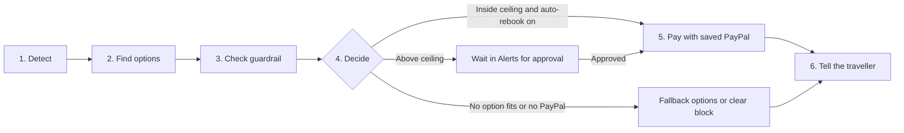

# Waypoint

**You plan the trip. Waypoint protects the journey.**

Waypoint is an autonomous travel-disruption concierge. It watches a traveller's bookings, and when a flight, train or bus is cancelled or delayed, or a hotel is overbooked, it finds a replacement, checks it against the traveller's own price limit, pays for it with their saved PayPal, and explains what it did.

---

## Table of contents

1. [The problem](#the-problem)
2. [The idea](#the-idea)
3. [How it works](#how-it-works)
4. [Features](#features)
5. [Tech stack](#tech-stack)
6. [Project structure](#project-structure)
7. [Getting started](#getting-started)
8. [Configuration](#configuration)
9. [Running the tests](#running-the-tests)
10. [Demo walkthrough](#demo-walkthrough)
11. [Deploying to Render](#deploying-to-render)
12. [Security](#security)
13. [Known limits](#known-limits)
14. [Roadmap](#roadmap)
15. [Team](#team)

---

## The problem

Plans break and deadlines do not move. A train is cancelled the day before a competition, a connection is missed, a hotel has no room. The traveller then spends three to four hours comparing options under stress, and often pays whatever is shown first.

## The idea

Give a travel agent three things that make it safe to act alone:

1. **A limit set by the traveller.** Budget comfort of low, medium or high.
2. **PayPal consent given once**, on PayPal's own page, so the agent can pay inside that limit without a popup.
3. **A human approval step** for anything above the limit.

**Design principle: AI suggests, rules spend.** AI helps with options, planning and explanations. Money decisions are made by plain, tested Python rules. The AI never moves money.

## How it works

One disruption goes through six steps:



1. **Detect.** An event arrives on the live feed: flight cancelled, cancelled plus a 30-hour delay, missed connection, or hotel overbooked. The demo controls publish these on purpose.
2. **Find options.** Waypoint builds alternatives: same route, another mode (for example train instead of flight), a nearby departure, or a hotel close to where the traveller usually stays.
3. **Check the guardrail.** Each option is tested against a ceiling: the original price times a multiplier, plus any saving left in the trip pool.
4. **Decide.** The outcome depends on the check (table below).
5. **Pay.** The replacement is charged to the saved PayPal. The old booking is refunded or voided.
6. **Tell the traveller.** An alert goes out by push, SMS or email with the reasoning, and the decision stays visible in the app.

### The guardrail

| Budget comfort | Ceiling multiplier |
|---|---|
| Low | 1.3 × original price |
| Medium | 1.6 × original price |
| High | 2.0 × original price |
| Pay-after items (such as hotels) | 2.5 × original price |

**Trip pool.** When a rebooking costs less than its ceiling, the saving is added to the trip pool and can raise the limit for a later disruption on the same trip.

### Decisions

| Situation | What Waypoint does | Who decides |
|---|---|---|
| Best option is inside the ceiling and auto-rebook is on | Rebooks and charges the saved PayPal, then notifies | The rules |
| Best option is above the ceiling | Stops and waits in Alerts with the options | The traveller approves or declines |
| No option fits, or PayPal is not saved | Shows fallback options, or blocks with a clear message | The traveller |

## Features

### Disruption handling
- Autonomous rebooking within the limit, with the reasoning shown for every decision.
- **Alerts:** approval screen for anything above the ceiling. Approve, decline, or choose another option.
- **Explore:** every alternative for a booking with a green or red guardrail verdict, and manual switching (a warning appears if the choice crosses the limit).
- **Compare view:** the original booking next to its replacement, line by line.
- **Past stays:** Waypoint learns where the traveller likes to stay and picks hotels near that area, only if the traveller allows it.

### Payments (PayPal sandbox)
- **Save PayPal once with the Vault.** The traveller approves on PayPal's page and Waypoint stores only a token.
- **Automatic charge with no popup** inside the limit. Authorize and capture for approval flows.
- **Cancel** a booking or a whole trip and see the refund. The PayPal payment is refunded or voided.
- **Transactions page:** every payment in a sortable AG Grid table.

### Live travel data
- Live train schedules, timings, running days and delays from **RailRadar**, merged across nearby stations.
- Live train running status by train number (for example `12919`), cross-checked against IRCTC and Where Is My Train on sample trains.
- Live flight options with durations, stops and prices from **HasData**.
- Train fares and seat availability are **never invented**. The chat points the traveller to IRCTC to verify them.
- Results are cached for 90 seconds, with HTTP timeouts and retries.

### AI chat concierge
- **Gemini** (`gemini-3.5-flash-lite`), with an LLM router that classifies each message and extracts the route and date.
- Understands **Hinglish and typos**. Example: `mujhe kal train se delhi se lucknow jana hai` is read as a train from Delhi to Lucknow tomorrow.
- Resolves relative dates ("kal", "parso", "tomorrow", "friday") using the current Asia/Kolkata date.
- Resolves regions and states to station groups ("Punjab" gives LDH, ASR, JUC, BTI) and looks up unlisted towns live. 100+ stations are covered.
- Replies **stream token by token** (`POST /api/chat/stream`). Greetings, account questions and 5-digit train numbers answer instantly without an LLM call.
- Chat history survives tab switches and refreshes, with a Clear chat button.
- Falls back to keyword rules when no Gemini key is set.
- **Travel-planning agent** (LangGraph with Gemini, built by Muskan) with a human approval step. It uses Postgres when available and an in-memory saver otherwise.

### Booking
- **Start a journey:** pick stations, date and budget, see options by class (1A, 2A, 3A, SL, CC) with green or red budget verdicts and labels (Best value, Fastest, Most comfortable), and book. The fare becomes the booking's baseline, so the same disruption protection applies.
- **New trip:** enter a trip already booked so Waypoint can protect it.

### Account and interface
- **Profile:** budget comfort, alert channel, permissions (auto-rebook, learn from history), contact card, avatar.
- Email OTP sign-in to verify a new account.
- Live feed in the browser through a WebSocket. Demo controls fire a disruption on a specific booking.

## Tech stack

| Layer | Technology | Role |
|---|---|---|
| Backend | Python 3.14, FastAPI, Uvicorn, Pydantic | REST API, validation, WebSocket live feed, SSE chat streaming |
| Database | SQLAlchemy on SQLite | Members, trips, bookings, decisions, payments, saved PayPal tokens (SQL Server via pyodbc is possible) |
| Event feed | Local event bus, optional Azure Event Hubs adapter | Delivers each disruption to the agent. The demo runs on the local bus |
| Decision engine | Plain Python guardrail | Ceiling, trip pool, approval rules. **No LLM involved** |
| Payments | PayPal REST API (sandbox): Orders v2, Refunds, Vault v3 | Authorize and capture, refund or void, save PayPal with consent, charge the saved account |
| Payment safety | `PayPal-Request-Id`, server-side amounts, rollback on failure | No double charge, no browser-chosen price, no half-created booking |
| Live train data | RailRadar API | Schedules, timings, running days, live status and delays, station search |
| Live flight data | HasData API | Flight options, durations, stops, prices |
| Data access | httpx, in-memory cache | 90-second cache, timeouts and retries |
| AI (router) | Gemini `gemini-3.5-flash-lite`, structured output | Classifies intent, extracts route and date, handles Hinglish and typos |
| AI (chat) | Gemini, keyword rules as fallback | Answers questions about trips, budget, limits and live travel data |
| AI (planning) | LangGraph, LangChain, Gemini, Postgres checkpointer (in-memory fallback) | Trip-planning flow with a human approval step |
| Frontend | React 18, Vite, AG Grid | Home, Explore, Profile, Chat, Start a journey, Transactions |
| Tests | pytest | Payment, booking, router and live-provider checks, all offline |

PayPal amounts use a fixed demo rate of ₹85 to $1, and the code refuses to run against live PayPal.

## Project structure

```
waypoint/
├── backend/
│   ├── app/
│   │   ├── main.py              # FastAPI app, routes, WebSocket
│   │   ├── agent.py             # Disruption agent: decide, approve, choose
│   │   ├── explore.py           # Explore, switch, bookings payloads
│   │   ├── chat.py              # Chat concierge
│   │   ├── chat_agent.py        # ADK chat agent
│   │   ├── router.py            # LLM router (intent, route, date)
│   │   ├── live_providers.py    # RailRadar and HasData clients
│   │   ├── journey.py           # Start a journey
│   │   └── config.py            # Environment configuration
│   ├── tests/                   # pytest suite
│   ├── travel_agent_langgraph_complete/   # LangGraph planning agent
│   ├── requirements.txt
│   └── .env.example
├── frontend/
│   ├── src/
│   │   ├── components/          # Chat, Profile, StartJourney, ...
│   │   ├── api.js               # REST helper
│   │   └── live.js              # WebSocket live feed
│   └── vite.config.js           # Dev proxy to the backend
├── azure/                       # Optional Azure adapters and notes
└── tableau/
```

## Getting started

### Prerequisites

- Python 3.14 (earlier 3.x versions may also work)
- Node.js 18 or newer
- A PayPal **sandbox** app (client ID and secret)
- API keys for RailRadar, HasData and Gemini (see [Configuration](#configuration))

### 1. Clone

```bash
git clone https://github.com/shub1504/waypoint-.git
cd waypoint-
```

### 2. Backend

```bash
cd backend
pip install -r requirements.txt
copy .env.example .env      # macOS or Linux: cp .env.example .env
```

Fill in `.env` (see [Configuration](#configuration)), then start the server:

```bash
python -m uvicorn app.main:app --reload
```

The API runs on `http://localhost:8000`.

### 3. Frontend

In a second terminal:

```bash
cd frontend
npm install
npm run dev
```

Open the URL Vite prints, usually `http://localhost:5173`. In development, Vite proxies `/api` and `/ws` to the backend on port 8000, so no extra setup is needed.

To check the production build:

```bash
npm run build
```

## Configuration

Copy `backend/.env.example` to `backend/.env`. **Never commit real keys.** `.env` files are gitignored.

| Variable | Required | Purpose |
|---|---|---|
| `GEMINI_API_KEY` | For AI chat | Gemini access. `GOOGLE_API_KEY` is accepted as an alias |
| `GEMINI_MODEL` | No | Defaults to `gemini-3.5-flash-lite` |
| `RAILRADAR_API_KEY` | For live trains | RailRadar schedules, status and delays |
| `HASDATA_API_KEY` | For live flights | HasData flight search |
| `PAYPAL_CLIENT_ID` | For payments | PayPal sandbox client ID |
| `PAYPAL_CLIENT_SECRET` | For payments | PayPal sandbox secret |
| `PAYPAL_BASE_URL` | For payments | PayPal sandbox API base URL |
| `CORS_ORIGINS` | For deployment | Comma-separated allowed frontend origins. Defaults to the local Vite URLs |
| `DATABASE_URL` | No | Empty means a local SQLite file |
| `EVENTHUB_CONNECTION_STRING`, `EVENTHUB_NAME` | No | Optional Azure Event Hubs. Leave empty to use the local bus |
| `LANGSMITH_API_KEY`, `LANGSMITH_TRACING`, `LANGSMITH_PROJECT` | No | Optional LangSmith tracing. Set `LANGSMITH_TRACING=false` outside development |

How keys are loaded: `config.py` reads `backend/.env` first, then `backend/app/.env`, and values in `backend/app/.env` win if the same name appears in both. Keep each key in only one file.

Payments are enabled only when both `PAYPAL_CLIENT_ID` and `PAYPAL_CLIENT_SECRET` are set. Without them the app runs in a no-payment mode.

## Running the tests

From `backend`:

```bash
python -m pytest
```

Expected result: **44 passed, 1 skipped**. All tests run offline.

The suite assumes PayPal is **not** configured. If your PayPal credentials are loaded, the auto-rebook tests will fail with `Save your PayPal first...`. To run the tests cleanly, temporarily hide the credentials file:

```bash
ren app\.env .env.off
python -m pytest
ren app\.env.off .env
```

Test files cover payments, the booking and disruption flows, the chat router, the live providers, and the planning agent schemas.

## Demo walkthrough

A short path through the product:

1. **Profile.** Set budget comfort, turn auto-rebook on, and save PayPal on PayPal's sandbox page.
2. **Fire a disruption** from the demo controls on a booking whose replacement is inside the ceiling. Watch Waypoint rebook, charge the saved PayPal with no popup, and show its reasoning. Open **Transactions** to see the payment.
3. **Fire a disruption above the ceiling.** The agent stops and waits in **Alerts**. Approve it to trigger authorize and capture.
4. **Chat.** Try `mujhe kal train se delhi se lucknow jana hai`, then `is 12919 late?`, then `cheapest flight DEL to BOM friday`.
5. **Explore and Compare** to see every alternative with its guardrail verdict.

Avoid pressing **Reset demo data** during a recording, since it clears the demo state.

## Deploying to Render

**Backend (Web Service)**

- Root directory: `backend`
- Build command: `pip install -r requirements.txt`
- Start command: `python -m uvicorn app.main:app --host 0.0.0.0 --port $PORT`
- Environment variables: all keys from the table above, plus `CORS_ORIGINS=https://<your-frontend>.onrender.com` and `LANGSMITH_TRACING=false`

**Frontend (Static Site)**

- Root directory: `frontend`
- Build command: `npm install && npm run build`
- Publish directory: `dist`
- Environment variable: `VITE_API_URL=https://<your-backend>.onrender.com` (set before the build, since Vite bakes it in)
- Rewrite: `/*` to `/index.html`

**Notes**

- The frontend reads `VITE_API_URL` for REST calls and for the WebSocket URL (`https` becomes `wss`). Locally it stays empty and the Vite proxy is used.
- SQLite data can be lost on restart, so seed the demo data after each deploy.
- A free instance sleeps when idle. Open the URL once before a demo.
- If the build fails on `pyodbc`, remove it from `requirements.txt`. SQL Server support is an optional adapter only.

## Security

**In place**

- PayPal runs in **sandbox only**, and the code refuses to start against live PayPal.
- **The AI never moves money.** The Python guardrail sets the ceiling, and anything above it needs the member's approval.
- Amounts are computed on the server. A changed fare sent from the browser is ignored.
- Each PayPal call carries an idempotency key, so a retry cannot charge twice.
- Failed charges roll back, so no booking is left half-created.
- Secrets live in `.env` files that are not committed.
- The chat never invents train fares or seat availability. It points to IRCTC for those.

To report a security issue, see `SECURITY.md`.

## Known limits

This is a hackathon build, and these limits are stated honestly:

- Demo sign-in has **no session tokens yet**, so routes trust the user ID sent by the app.
- No rate limiting on OTP or payment routes.
- Live train and flight data come from third-party APIs (RailRadar, HasData), not from IRCTC directly.
- Live status was cross-checked against IRCTC and Where Is My Train on sample trains, not on every train.
- The LangGraph planning agent uses Postgres when configured and an in-memory saver otherwise.
- Azure Event Hubs and SQL Server are optional adapters. The demo uses the local bus and SQLite.
- The exchange rate is fixed at ₹85 to $1 for the demo.

## Roadmap

- Sign-in tokens and per-user authorization on every route
- Rate limits on OTP and payment endpoints
- Disable `/docs` outside development
- Review the planning agent's payment and approval nodes, turn LangSmith tracing off by default, stop returning raw errors and thread IDs to the browser, and tighten CORS
- Prompt-injection tests on the chat and the agent
- Real fares and seat availability
- Azure Event Hubs and a hosted database for a real deployment
- Key rotation and a secrets manager

## Team

- **Shubhangi** (@shub): backend, payments, OTP sign in
- **Aryan** :  live data, chat router, agent development
- **Muskan**: UI, AG Grid tables, 

## Future enhancements

- Detect disruptions automatically. Replace the demo controls with real triggers: live delay and cancellation feeds, and a watcher that checks upcoming bookings on a schedule.
- Real notifications. Deliver the alerts through working push, SMS, whatsapp and email channels, with deep links straight to the approval screen.
- More modes and stays. Add buses, cabs and hotel inventory as first-class options, and use the past-stays signal to rank hotels better.
- Shared trip pool functionality for group travelling
- More languages. Extend the Hinglish understanding to other Indian languages, and add voice input for travellers in a hurry.
- Smarter limits. Let travellers set limits per trip or per booking, and show how much of the trip pool is left.
- Local travel options triggered once the traveler comes in 500m range of the destined station, airport or bus stop to the actual destination
